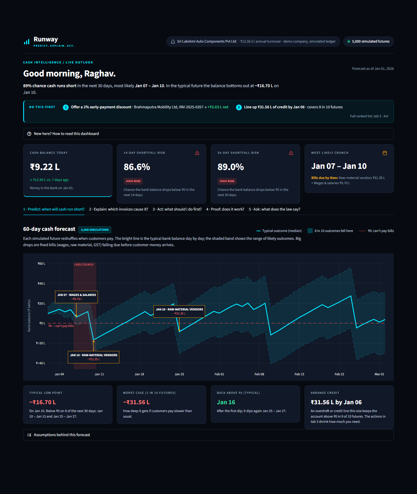
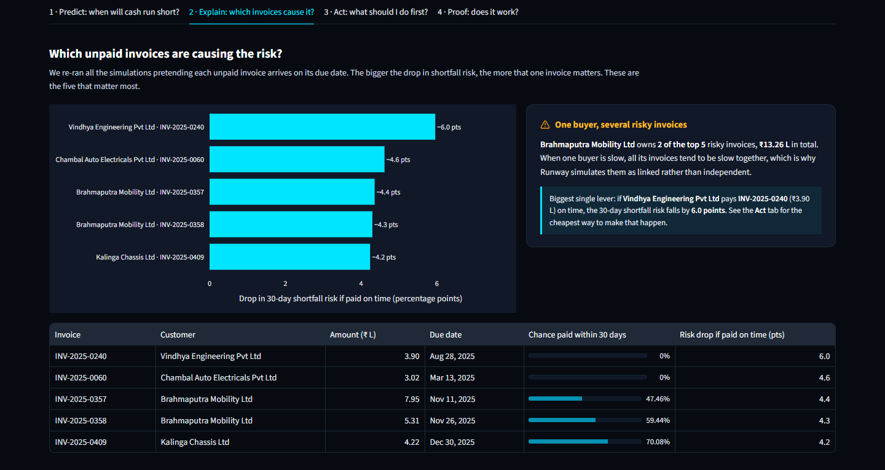
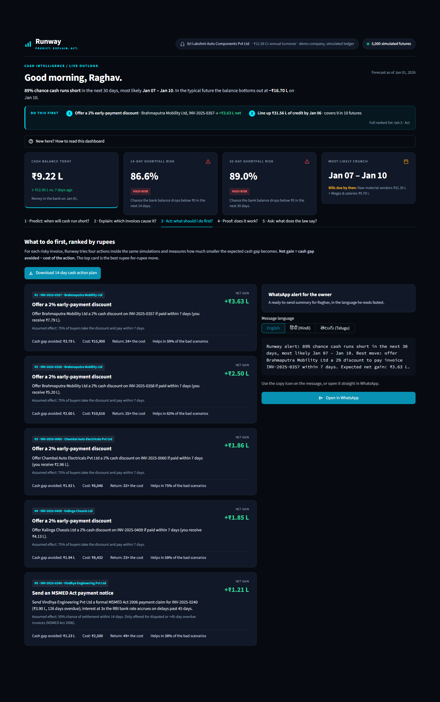
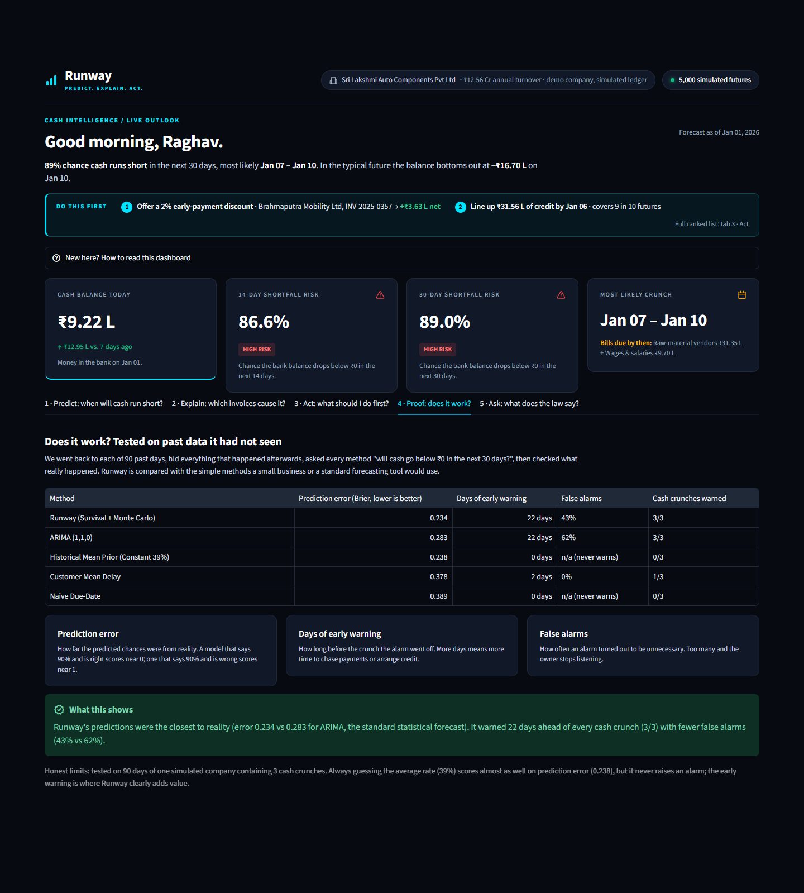
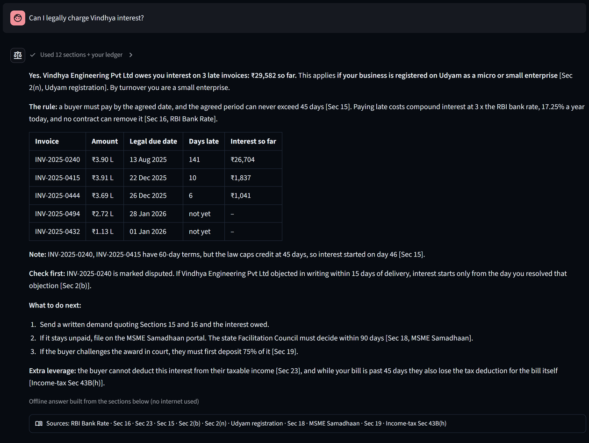
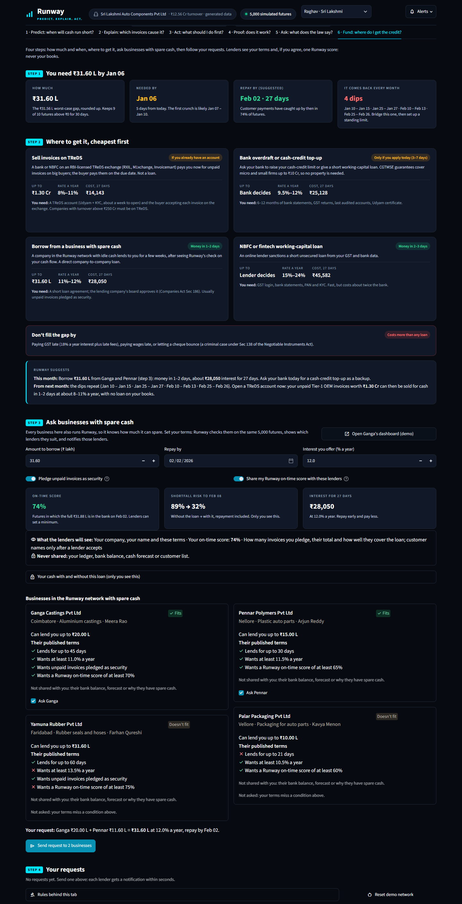
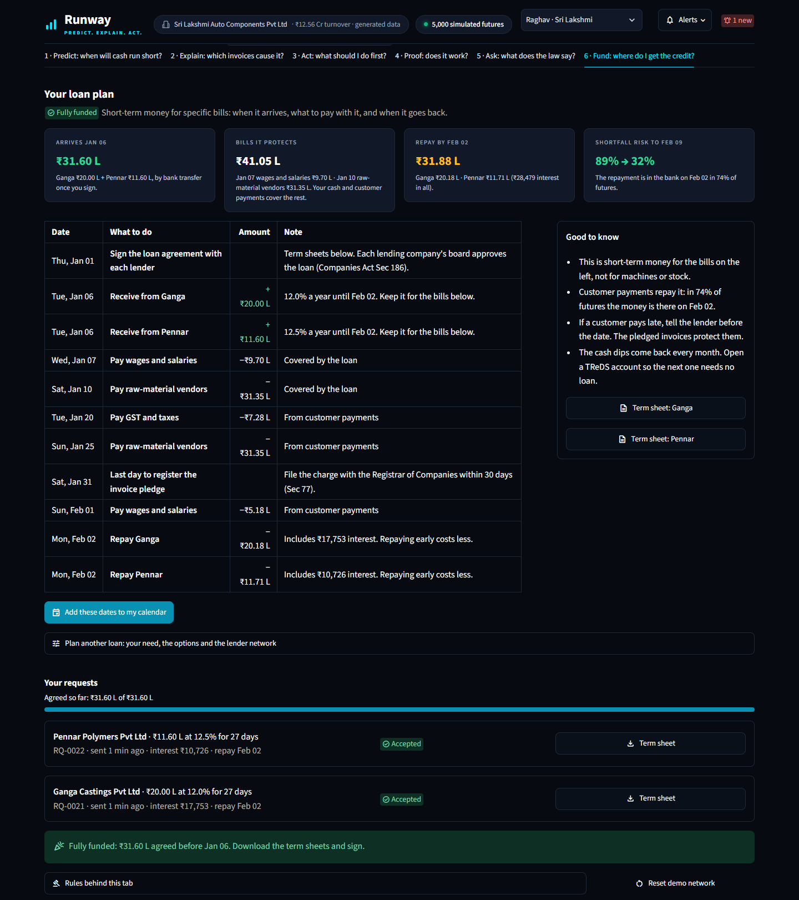
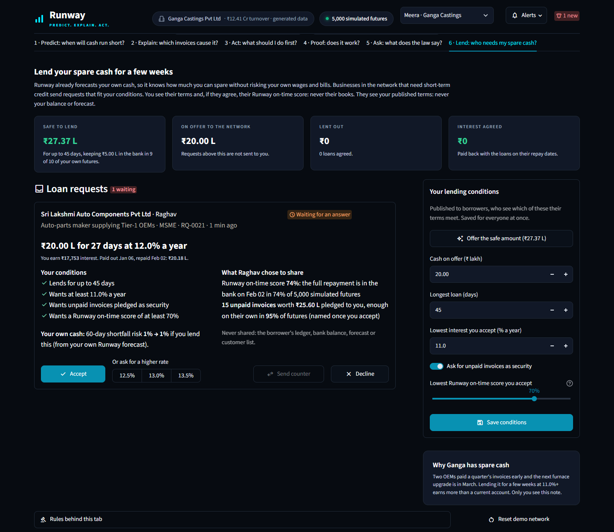

# Runway — Cash-Shortfall Early Warning for Indian MSME Manufacturers

**INNOVASIA 2K26 · Problem Statement PS-04 · Team Fin-Hack**

### ▶ Live demo: **[runwayhi.streamlit.app](https://runwayhi.streamlit.app/)**

[](https://runwayhi.streamlit.app/)

> The first visit after the app has been idle takes about 30 seconds while it runs 5,000 simulations.
> Runs on a simulated auto-parts supplier; no real company data is used.

Accounting tools tell a factory owner which invoices are *already* overdue. Runway tells them
**how likely they are to run out of cash in the next 14, 30 and 60 days, which invoices are
causing it, and what to do first** — ranked in rupees.

| | Question it answers | How |
|---|---|---|
| **Predict** | *Will I run short of cash, and when?* | Survival model of invoice payment timing + 5,000-path Monte Carlo cash simulation |
| **Explain** | *Which invoices are driving the risk?* | Counterfactual attribution: re-run the simulation as if invoice *k* were paid on time |
| **Act** | *What should I do first?* | Every candidate action ranked by `E[shortfall avoided] − cost of action` |
| **Prove** | *Is it better than a spreadsheet?* | Rolling no-look-ahead backtest against 3 baselines, scored by Brier score and warning lead time |
| **Ask** | *Can I legally charge this customer interest?* | RAG over the MSMED Act 2006 + the business's own invoices; Gemini or Claude writes the answer online, a built-in answer works offline |
| **Fund / Lend** | *Where do I get the ₹31.6 L, and who will lend it?* | Credit sources compared for this exact loan; businesses with spare cash (each with its own Runway dashboard and a Lend tab) get the request with a notification and only the on-time score the borrower chose to share |

---

## Screenshots

**1 · Predict: when will cash run short?** The first screen states the risk, the likely crunch window
and the typical low point, then a **"Do this first"** bar with the best action and the credit line to
arrange (amount and date). Below it: a 60-day forecast across 5,000 simulated futures with the real bills
behind each drop, how bad it gets (typical low, worst case in 1 of 10 futures, days below ₹0) and an
**Assumptions** panel.



**2 · Explain: which invoices cause it?** The five unpaid invoices whose late payment adds most to
the risk, found by re-running the simulation as if each were paid on time, plus the combined effect:
if the top three are all paid on time, the 30-day risk falls from 89% to 67%.



**3 · Act: what should I do first?** Actions ranked by net rupee gain, a downloadable **14-day cash
action plan** (CSV: ranked actions, when to line up credit, every bill due), and a ready-to-send
WhatsApp alert in English, Hindi or Telugu.



**4 · Proof: does it work?** A 90-day backtest on data the model had not seen, against four simpler methods.



**5 · Ask: what does the law say?** A RAG legal assistant on the MSMED Act 2006 and the company's own
invoices: *"Can I legally charge Vindhya interest?"* → ₹29,582 so far, with the sections it relied on.



**6 · Fund: where do I get the credit?** How much (₹31.60 L), by when (Jan 06) and for how long (repay
Feb 02, 27 days), then every realistic source priced for this loan: TReDS invoice sale, bank cash-credit
top-up, a loan from a business with spare cash, an NBFC loan. Raghav sets his terms and sees exactly what
a lender will see; Runway shows which lenders the terms suit (and which condition fails for the others),
then sends the request. He sees each lender's name, business and published terms, never its balance or
forecast. Answers and counter-offers arrive in the bell at the top.



**Once lenders say yes, the dashboard changes.** The headline, the "Do this first" bar, the 30-day risk card
(89% → 10% with the loans) and the forecast chart (a dashed "with the agreed loans" line) all update on
their own, and tab 6 becomes **Your loan plan**: when the money arrives, the bills it protects, what to repay
to whom and when, a dated to-do table, term sheets, and an "Add these dates to my calendar" file (.ics) with
a reminder the day before each date.



**The lender's side: the same dashboard, with a Lend tab.** Every lender is a Runway business too
(`?as=ganga`, or *Signed in as* at the top), with its own generated ledger and forecast, so Runway knows how
much it can safely lend (₹27.37 L for 45 days for Ganga Castings, keeping ₹5 L in the bank in 9 of 10
futures). A request that fits its conditions lights up the bell, where it can be accepted in one click. The
Lend tab shows the terms, the borrower's on-time score (only if shared), a summary of pledged invoices
(customer names only after accepting) and what the loan does to the lender's own shortfall risk. After
accepting, it shows the lender's loan book: when to pay out, when the money comes back, the interest, and
the same calendar file.



---

## Sample output (synthetic demo company, as of 1 Jan 2026)

```
Starting cash        ₹9.22 L
P(deficit)           86.6% (14d) · 89.0% (30d) · 92.8% (60d)
Likely shortfall     Day 6 – Day 9  (wages on the 7th + raw-material payment on the 10th)
Top risk driver      INV-2025-0240, Vindhya Engineering, ₹3.90 L  → paying it cuts 30d risk by 6.0 pts
Best action          2% early-payment discount on INV-2025-0357 (Brahmaputra Mobility)
                     avoids ₹3.79 L of expected shortfall for ₹15,900 → net ₹3.63 L
Credit to arrange    ₹31.60 L by Jan 06, repay Feb 02 (27 days, ₹28,050 at 12%)
                     repayment in the bank on time in 74% of futures; risk to Feb 08: 89% → 32%
```

---

## Quick start

Requires Python 3.10+ (tested on 3.11, Windows 11).

```bash
python -m venv venv
venv\Scripts\activate            # macOS/Linux: source venv/bin/activate
pip install -r requirements.txt

python demo.py                   # end-to-end CLI walkthrough (~35 s)
streamlit run app/main.py        # dashboard
```

**Optional: let an AI model write the Ask tab's answers.** Without a key the legal assistant runs fully
offline. Add either key (or both, and pick in the app) to `.streamlit/secrets.toml` (git-ignored), as an
environment variable, or on Streamlit Cloud under *App settings → Secrets*:

```toml
GEMINI_API_KEY = "AIza..."      # free key from aistudio.google.com; model defaults to gemini-3.6-flash
# GEMINI_MODEL = "gemini-3.5-flash-lite"   # optional override, e.g. for a higher free-tier quota
ANTHROPIC_API_KEY = "sk-ant-..."  # Claude Opus 5.5, paid
```

Google may use prompts sent on Gemini's free tier to improve its products; use a paid tier for real
company data.

> **pandas is pinned below 3.0.** On some Windows machines, Application Control blocks the pandas 3.x
> DLLs; 2.x works everywhere we tested. The same policy can block new `pyarrow` builds (the dashboard
> then fails on its tables): run `pip install pyarrow==18.1.0` to fix it locally. If it blocks
> `pydantic_core` (needed by the `anthropic` SDK), run `pip install pydantic==2.10.6 jiter==0.8.2`.
> Streamlit Cloud is unaffected.

### Every backend module runs its own self-test

| Command | What it shows | Time |
|---|---|---|
| `python data/generator.py` | Generates the ledger, writes `data/sample_ledger.csv` + `data/sample_expenses.csv`, prints stats | ~10 s |
| `python engine/survival_model.py` | Fits Cox PH (and Weibull fallback), concordance, per-invoice payment curves | ~5 s |
| `python engine/monte_carlo.py` | P(deficit), P10/P50/P90 bands, shortfall window, top-5 drivers, effect of correlation | ~15 s |
| `python engine/optimizer.py` | Ranked actions; checks the fast scoring path matches a full re-simulation | ~30 s |
| `python evaluation/backtest.py` | 90-point rolling backtest vs. 3 baselines + calibration curve | ~4 min |
| `python evaluation/tuner.py` | Cross-validated penalizer grid search, writes `evaluation/tuning_report.json` | ~20 s |
| `python -m unittest tests.test_security_and_edge_cases -v` | Input sanitizer + engine edge cases (6 tests) | <1 s |
| `python -m unittest tests.test_assistant -v` | Legal assistant: interest maths, retrieval, offline answers (15 tests) | <1 s |
| `python -m unittest tests.test_engine_extras -v` | Joint "these invoices paid on time" risk (4 tests) | ~5 s |
| `python -m unittest tests.test_funding -v` | Fund / Lend: loan checks, safe-to-lend, several loans at once, security, credit sources, lending network, calendar file (21 tests) | ~5 s |

Run them from the repository root.

### Use it from Python

```python
from engine import run_runway_pipeline

# Synthetic demo company
result, actions, sim = run_runway_pipeline()

# Your own ledger (same columns as data/sample_ledger.csv and data/sample_expenses.csv)
result, actions, sim = run_runway_pipeline(invoices_df, expenses_df, starting_cash=9_22_000,
                                           as_of_date="2026-01-01")

result.p_deficit_30d          # 0.89
result.shortfall_window_dates # ('2026-01-07', '2026-01-10')
result.top_risk_invoices      # top-5 drivers with marginal risk reduction
actions[0]                    # ActionRecommendation with net_benefit, cost, confidence
```

---

## How it works

```
 invoices ──► InvoiceSurvivalModel ──► P(paid by day d | still unpaid today)   (n_invoices × 60)
                                                  │
 expenses calendar ───────────────────────────────┤
 (payroll, GSTR-3B, EMI, raw material)            ▼
                                     CashFlowSimulator (5,000 correlated paths)
                                                  │
                     ┌────────────────────────────┼─────────────────────────────┐
                     ▼                            ▼                             ▼
          P(deficit) at 14/30/60d     counterfactual top-5 drivers     InterventionOptimizer
          P10/P50/P90 fan chart       ("what if this invoice           ranked by net ₹ benefit
          shortfall window             were paid on time?")
```

### 1. Synthetic ledger — [`data/generator.py`](data/generator.py)
A realistic auto-components supplier: 25 customers, 500 invoices, ~₹12.6 Cr turnover.
- **Three customer segments** with different behaviour: Tier-1 OEMs (big invoices, 45–60 day terms,
  pay late but reliably), mid-tier suppliers, and retail distributors (small, bimodal, some bad debt).
- **Customer frailty** (some customers are persistently slower) and **stress episodes** that delay
  all of a customer's invoices at once.
- **Disputes** add 30–90 days of delay; a quarter of disputed invoices are never paid.
- **Indian compliance calendar**: salaries on the 1st, wages on the 7th (Payment of Wages Act),
  EMI/rent on the 5th, GSTR-3B on the 20th, advance tax quarterly, raw material on the 10th/25th.
- Unpaid invoices at the as-of date are **right-censored**, exactly like a real ledger.

### 2. When will each invoice be paid? — [`engine/survival_model.py`](engine/survival_model.py)
Instead of classifying invoices as "late / not late", Runway models **when** payment arrives as a
survival curve S(t), which handles unpaid (censored) invoices correctly.
- **Cox proportional hazards** (lifelines), falling back automatically to **Weibull AFT** if Cox fails to converge.
- Features: invoice size, customer segment, payment terms, the customer's past average delay
  (segment average for new customers), dispute flag.
- Predictions are **conditional on what we already know**: an invoice 20 days overdue gets
  P(paid in next d days | not paid in the first 20).
- Concordance on the sample ledger: **0.715** (Cox), 0.677 (Weibull).

### 3. Cash simulation — [`engine/monte_carlo.py`](engine/monte_carlo.py)
- 5,000 paths × 60 days, fully vectorised in NumPy.
- **Correlated lateness via a Gaussian copula** (ρ = 0.5): when an OEM is slow, all its invoices are
  slow together. Ignoring this understates the bad tail — on the demo data the worst-10% day-30
  balance is −₹12.5 L with correlation vs −₹3.1 L without.
- Outputs P(cash < 0) at 14/30/60 days, P10/P50/P90 bands, and the likely shortfall window.
- **Risk drivers**: for each open invoice, re-run the *same* random paths as if it were paid on its
  due date; the drop in P(deficit) is its contribution. Top 5 are reported.
  `joint_counterfactual_risk()` does the same for several invoices at once (top 3 on time: 89% → 67%).
- **Severity, not just risk**: the dashboard also reports the typical low point, the 1-in-10 worst
  low (which sets the credit line to arrange, and by when) and the days the typical balance is below ₹0.

### 4. What to do first — [`engine/optimizer.py`](engine/optimizer.py)
Four actions are simulated per risky invoice, each changing only that invoice's payment curve:

| Action | Effect modelled | Cost |
|---|---|---|
| `DIRECT_CHASE` | Payment curve moves 10 days earlier | ₹500 |
| `EARLY_DISCOUNT_2%` | 75% chance of payment within 7 days | 2% of invoice |
| `SPLIT_PAYMENT` | 50% now, 50% in 30 days (if accepted; assumed 60%) | ₹300 |
| `LEGAL_MSMED_NOTICE` | 50% chance of settling within 14 days; only for disputed or >45-day overdue invoices (MSMED Act) | ₹2,500 |

Expected shortfall = average over paths of the worst cash dip in 30 days.
**Net benefit = shortfall avoided − cost.** Actions reuse the baseline random numbers, so differences
are due to the action, not simulation noise.

### 5. Evaluation — [`evaluation/backtest.py`](evaluation/backtest.py), [`evaluation/baselines.py`](evaluation/baselines.py)
At each of 90 daily evaluation points, every model sees **only data available that day** (later
payments hidden, survival model refit) and predicts P(cash goes negative within 30 days).
The prediction is then compared with what actually happened.

| Model | 30d Brier ↓ | Warning lead time ↑ | False warnings ↓ | Deficit onsets warned |
|---|---|---|---|---|
| **Runway** | **0.234** | **22 days** | **43%** | **3/3** |
| ARIMA(1,1,0) on daily net cash flow | 0.283 | 22 days | 62% | 3/3 |
| Constant base rate (always 39%) | 0.238 | — | never warns | 0/3 |
| Customer mean delay | 0.378 | 2 days | 0% | 1/3 |
| Naive due-date | 0.389 | 0 days | never warns | 0/3 |

Warning = P(deficit) > 40%. Saved in [`data/benchmark_results.csv`](data/benchmark_results.csv).

**Reading this honestly:** Runway has the best Brier score and the best false-warning rate, and ties
ARIMA on lead time. But its Brier edge over a constant base-rate guess is small, the window contains
only 3 deficit episodes, and daily evaluation points overlap heavily. This is one synthetic company
and one seed — evidence that the pipeline works, not a statistical proof.

### 6. Input safety — [`data/sanitizer.py`](data/sanitizer.py)
For user-uploaded ledgers: neutralises spreadsheet formula injection (`=`, `+`, `-`, `@`), masks
GSTIN / PAN / bank account numbers, fixes inverted dates, drops duplicate invoice IDs and negative
amounts, and normalises segment / category names.

### 7. Legal assistant (RAG) — [`assistant/`](assistant/)
The *Ask* tab answers questions such as *"Can I legally charge Vindhya interest?"* in three steps:

1. **Retrieve.** BM25 keyword search ([`retriever.py`](assistant/retriever.py)) over the exact text of the
   MSMED Act 2006, Sections 2, 8 and 15–24, plus a few dated notes: the RBI Bank Rate, Udyam registration,
   the April 2025 MSME size limits, Income-tax Section 43B(h) and the MSME Samadhaan portal
   ([`legal_corpus.py`](assistant/legal_corpus.py)). A small synonym table covers everyday and Hinglish
   words ("byaj" → interest). Pure Python, no model download.
2. **Ground.** Pull the business's own numbers: unpaid invoices of any customer named in the question and
   the Section 16 interest on each ([`interest.py`](assistant/interest.py)). That interest is compound with
   monthly rests at 3 × the RBI Bank Rate, starting the day after the agreed date, capped at 45 days
   (Section 15). The 30-day forecast is added too.
3. **Generate.** With a `GEMINI_API_KEY` (Gemini 3.6 Flash, called over plain HTTPS) or an
   `ANTHROPIC_API_KEY` (Claude Opus 5.5), the model writes the answer from those passages and numbers
   only, citing sections like `[Sec 16]`, in the language of the question. Without a key, or when the
   network or API fails, a template answer is built from the same passages and numbers
   ([`advisor.py`](assistant/advisor.py)).

Every answer lists its sources, with the statute text and the ledger numbers it used. The cash forecast
itself never uses an LLM.

### 8. Funding the gap — [`funding/`](funding/)
The *Fund* tab turns "arrange ₹31.56 L of credit" into where to get it and who will lend it. Lenders are
Runway businesses too: each has its own generated ledger (a different generator seed plus spare opening
cash), its own dashboard and a *Lend* tab in place of *Fund*.

- **How much, from when, for how long** ([`plan.py`](funding/plan.py)). The amount is the worst 1-in-10 low
  over 30 days (rounded up), needed a day before the first likely crunch. The repay date is the one that
  keeps the most simulated futures above ₹0 from the loan's start until a week *after* repaying, so the
  repayment does not just move the crunch to the next wage day. Every loan is checked on the same 5,000
  futures: the **on-time score** (share of futures with the full repayment in the bank on the date) and the
  shortfall risk with and without the loan.
- **Where to get it.** TReDS invoice sale (undisputed, not-yet-due invoices on Tier-1 OEM buyers), a bank
  cash-credit top-up, a loan from a business with spare cash, and an NBFC loan, each priced for this loan
  and marked by whether the money can arrive in time. Rates and timings are typical ranges, not quotes.
- **Security.** For each lender, the invoices most likely to be paid before the repay date are pledged until
  they are worth 125% of what is owed; Runway reports in what share of futures they alone would repay it.
  No invoice is pledged twice.
- **Safe to lend.** For a lender, the 1-in-10 lowest balance over its longest loan period minus a ₹5 L
  cushion: lending that much still keeps ₹5 L in the bank in 9 of 10 of its own futures. Each request also
  shows the lender its own 60-day shortfall risk with and without the loan.
- **The lending network** ([`network.py`](funding/network.py)). Four fictional companies with spare cash,
  each with its own conditions (amount, longest loan, lowest rate, security, lowest on-time score). Requests
  are split across the lenders that fit, cheapest first. One thread-safe in-memory store is shared by every
  browser session (`st.cache_resource`). A notification bell in the header of both dashboards polls it
  every 3 s: a toast and a count for anything new, and one-click answers (accept, decline, accept a
  counter-offer) without leaving the current tab. An accepted request produces a term sheet.
- **Privacy, both ways.** A lender sees the borrower's name, the terms, the on-time score (only if the
  borrower turns sharing on) and a count, total and cover of pledged invoices. Customer names on those
  invoices appear only after the lender accepts, because the pledge must name them. A borrower sees a
  lender's name, business and published terms. Neither side sees the other's ledger, balance or forecast,
  and the Fund tab shows the borrower exactly what will be sent before sending.
- **After a deal.** `apply_loans()` adds every agreed loan to the same simulated futures (money in on the
  start day, out with interest on the repay day; the reverse for a lender), so the 30-day risk, the chart
  and the loan plan are recomputed, not described. The notification bell notices a new agreement and
  redraws the whole dashboard. `calendar_ics()` turns the dated to-do list into a calendar file.
- **Rules it follows.** Runway never lends, holds or moves money. A company-to-company loan needs the lender
  board's approval and a rate not below the government-bond yield for a similar period (Companies Act 2013,
  Sec 186), and a pledge of invoices is a charge to register within 30 days (Sec 77). RBI's P2P rules cap a
  borrower at ₹10 lakh across platforms, which is why this is a direct company-to-company loan.

---

## Repository layout

```
runway/
├── demo.py                    CLI walkthrough of Predict → Explain → Act
├── app/main.py                Streamlit dashboard (Predict / Explain / Act / Proof / Ask, then Fund or
│                              Lend); ?as=<business> signs in as Raghav or one of the lenders
├── funding/
│   ├── plan.py                Loan check on the simulated futures, repay date, safe-to-lend, security,
│                              credit sources
│   └── network.py             Lenders, requests, answers and term sheets (shared in-memory store)
├── assistant/
│   ├── legal_corpus.py        MSMED Act 2006 text (Secs 2, 8, 15–24) + dated notes
│   ├── retriever.py           BM25 search with everyday / Hinglish synonyms
│   ├── interest.py            Section 16 interest per unpaid invoice
│   └── advisor.py             Grounding facts, offline answers, Gemini / Claude streaming
├── .streamlit/config.toml     Dark theme for the dashboard
├── data/
│   ├── schemas.py             Shared dataclasses + segment / expense constants
│   ├── generator.py           Synthetic MSME ledger + cash-history reconstruction
│   ├── sanitizer.py           Input validation & PII masking
│   ├── sample_ledger.csv      Pre-generated invoices (seed 42)
│   ├── sample_expenses.csv    Pre-generated expense calendar
│   └── benchmark_results.csv  Backtest table shown in the dashboard
├── engine/
│   ├── __init__.py            run_runway_pipeline() — one call, end to end
│   ├── survival_model.py      Cox PH / Weibull AFT payment-timing model
│   ├── monte_carlo.py         Correlated cash-flow simulation + risk attribution
│   └── optimizer.py           Action ranking by net ₹ benefit
├── evaluation/
│   ├── baselines.py           Naive due-date, customer mean delay, ARIMA(1,1,0)
│   ├── backtest.py            Rolling no-look-ahead backtest
│   └── tuner.py               Penalizer grid search + calibration error
├── tests/                     Unit tests
├── docs/screenshots/          Dashboard screenshots used in this README
└── PLAYBOOK.md                Engineering plan and build prompts
```

## Known limitations

- All results are on **synthetic data** generated from one seed. Real ledgers will need recalibration.
- The action effects (e.g. "75% pay within 7 days after a 2% discount", "60% accept a split") are
  **assumptions**, not estimates from data.
- The dashboard runs on the synthetic company; there is no CSV upload flow yet, so the sanitizer is
  not yet wired into the app.
- The legal assistant gives general information from the Act's text, not legal advice. Its interest
  figures assume acceptance on the invoice date and use today's bank rate for the whole period.
  Written objections by the buyer (which delay the clock) are not in the data.
- The forecast ignores new sales made after the ledger date and credit lines already in place, so it
  leans cautious.
- The lending network is a demo: four fictional lenders with generated ledgers, kept in memory (a restart
  clears it) and shared by everyone using the same server. *Signed in as* switches company without a
  login; a real deployment needs accounts. Credit-source rates and timings are typical ranges, not quotes.
  Run for real, the matching would go through an RBI-regulated partner.

## What's next

- **What-if planner:** pick actions (collect an invoice early, delay a vendor, draw on credit) and see the
  new risk, low point and recovery date recalculated on the same simulated futures.
- **Real ledgers:** Tally / Zoho import through the existing sanitizer.
- **Learned action effects:** replace the stated assumptions with each buyer's observed responses.
- **Weekly risk trend** and a **cash-bridge view** of the crunch week; TReDS invoice discounting as an action.
- **A real lending network:** verified lenders in a database, e-signed loan agreements, and email or
  WhatsApp notifications alongside the in-app ones.
